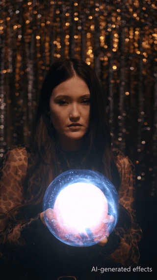
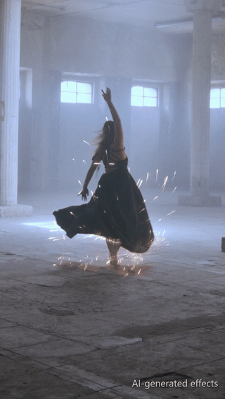

<h1 align="center">
  <picture>
    <source media="(prefers-color-scheme: dark)" srcset="docs/assets/branding/logo-on-dark.svg">
    <source media="(prefers-color-scheme: light)" srcset="docs/assets/branding/logo-on-light.svg">
    
  </picture>
</h1>

<p align="center"><strong>AI effects that sit in the shot.</strong></p>

<p align="center">
  <a href="#get-started">Get started</a> ·
  <a href="#your-first-effect">Your first effect</a> ·
  <a href="#make-your-own-effects">Your own effects</a> ·
  <a href="#more-examples">Examples</a> ·
  <a href="#documentation">Documentation</a>
</p>

Add fire, lightning, smoke and particles to your own footage in ComfyUI. Track effects through your shot, adjust their light and colour, and export the result or separate EXR passes.

Use the app for a guided workflow, or connect the nodes in your own graph. AI effects are generated locally with **LTX-2.5**; selected particle styles run without AI generation.

https://github.com/user-attachments/assets/468b014c-f544-41fe-b26f-fd6da37d78a3

<p align="center"><em>The release video.</em> <a href="https://youtu.be/Cz7dW70VSNg">Watch it on YouTube</a><br><sub>AI-generated effects; stock footage.</sub></p>

<br>

## What you can do

The app guides you through five steps:

<table>
  <tr>
    <td width="33%" valign="top">
      <h3>1 · Clip</h3>
      Load a <b>video or a picture</b>. <b>Depth, normals and camera motion</b> are worked out once per clip.
    </td>
    <td width="33%" valign="top">
      <h3>2 · Position & Track</h3>
      Click where the effect belongs. It follows a <b>point, an object or the camera</b>, and <b>hides behind the object</b> with its mask.
    </td>
    <td width="33%" valign="top">
      <h3>3 · Effect · Basic</h3>
      Choose one of <b>26 styles</b> or <b>describe your own</b>. <b>LTX-2.5</b> generates it on your clip; drawn styles need no AI.
    </td>
  </tr>
  <tr>
    <td width="33%" valign="top">
      <h3>3 · Effect · Advanced</h3>
      Build particle simulations <b>live, without AI</b>. Depth, masks and tracks let them <b>hide, collide and move with the scene</b>.
    </td>
    <td width="33%" valign="top">
      <h3>4 · Scene & finish</h3>
      Change light, glow, colour and placement <b>live, without a new run</b>. Combine <b>several effects</b> on one clip.
    </td>
    <td width="33%" valign="top">
      <h3>5 · Output</h3>
      Compare versions and export video or <b>scene-linear EXR passes</b>, with <b>NVIDIA × 2 or HDR</b>, even for the clip alone.
    </td>
  </tr>
</table>

Choose from fire, lightning, sparks, smoke, magic, weather, debris, liquid and dissolve styles, or describe your own effect. The app identifies experimental styles before you generate.

### All features

<details>
<summary><b>1 · Clip</b> &nbsp;·&nbsp; load, analyse, grade</summary>
<br>

- **Sources**<br>Load a video or a still picture. In a node graph, EF Shot also accepts frames with a frame rate.
- **Analysis**<br>Depth, surface normals and camera motion are worked out once per clip. Every effect on the clip reuses them.
- **Clip grade**<br>Brightness, warmth, colour strength and a depth blur that keeps the focus on the effect.

</details>

<details>
<summary><b>2 · Position & Track</b> &nbsp;·&nbsp; points, objects, camera, masks</summary>
<br>

- **What it follows**<br>Click where the effect belongs. It follows that **point**, the whole **object**, the **scene** while the camera moves, or stays fixed on **screen**.
- **Two points**<br>Shift-click a second point for effects that connect two positions, such as lightning or energy.
- **Track check**<br>An object word helps find what to follow. The track check shows the path before you generate.
- **Masks**<br>Hide an effect behind the selected object with its mask, or keep the base of an effect on its tracked point.

</details>

<details>
<summary><b>3 · Effect · Basic</b> &nbsp;·&nbsp; 26 styles, three ways to make them</summary>
<br>

- **Styles**<br>26 styles in ten groups, from flames and lightning to snow, liquid and dissolve, plus your own effect.
- **Three routes**<br>**Overlay** generates the element separately. **Inpaint** generates it inside the footage for contact with surfaces. **Drawn styles** use particles without AI generation.
- **Words**<br>Describe the look, motion and contact. **Enhance** can refine them when a language model is installed. With the optional Bonsai model, **Describe what you want** suggests a style and its words; you see each change before you apply it.
- **Guides**<br>Guide the AI with the object's shape, a path you paint on the canvas, or simulated particles.
- **Preview first**<br>Start with a fast **Preview**, then **Make final** for the full-size version. **Add passes** creates missing passes without generating the effect again.
- **NVIDIA**<br>Optional NVIDIA upscaling and HDR.

</details>

<details>
<summary><b>3 · Effect · Advanced</b> &nbsp;·&nbsp; live particle simulation, without AI</summary>
<br>

- **Live, without AI**<br>The **Emitter** shows every control of a particle style. The live preview simulates the particles on your clip with the same engine and seed as the run.
- **Part of the scene**<br>The clip's depth hides particles behind nearer objects and lets them bounce, stick, slide or die on surfaces. The object's mask and track carry the emitter; the clip's motion and the camera move them along.
- **Three uses**<br>Keep the simulation as the finished effect, let it guide LTX-2.5, or draw it over the AI element.
- **Out of the box**<br>Every particle style starts from tested values. Changed values are marked and go back one by one.
- **Keep it**<br>**Save as my effect** stores the emitter values for every clip. See [Make your own effects](#make-your-own-effects).

</details>

<details>
<summary><b>4 · Scene & finish</b> &nbsp;·&nbsp; light, glow, timing, versions</summary>
<br>

- **Light and colour**<br>Set the light the effect throws on the scene, its glow, brightness and colour. An effect can also be **lit by the other effects**, such as smoke near a flame.
- **Placement and timing**<br>Move, scale and rotate the effect in the canvas. The timeline sets start, end and fades; Advanced adds keyframes.
- **Several effects**<br>Add several effects to one clip, each with its own settings and versions.
- **Versions**<br>Keep versions, compare them and restore their settings.

</details>

<details>
<summary><b>5 · Output</b> &nbsp;·&nbsp; formats, EXR passes, NVIDIA, element library</summary>
<br>

- **Formats**<br>Export the composite as MP4, ProRes, H.265 10-bit, PNG or EXR.
- **Passes**<br>Export separate scene-linear EXR passes for your compositor: effect passes, plate, depth, normals and the object's mask, each on its own.
- **The clip alone**<br>Export a clip without an effect, with its passes, NVIDIA upscaling or HDR.
- **NVIDIA on the plate or the comp**<br>Run NVIDIA upscaling and HDR on the plate only, with the effects kept as they are, or on the finished comp.
- **Element library**<br>Save an AI element to a library and place it in other shots without generating it again.
- **Other generators**<br>Bring frames from another generator into the placement workflow with **EF Element from Images**.

</details>

<details>
<summary><b>Node graph</b> &nbsp;·&nbsp; the same graphs as ordinary nodes</summary>
<br>

- **Template**<br>The **Element Forge** template uses the same graphs as the app, as ordinary ComfyUI nodes.
- **Building blocks**<br>**EF Unpack** exposes the footage, element, alpha and passes. Compositing tools include glow, depth light, unmult, deflicker and dither.
- **Scripting**<br>The graphs in `api_workflows/` can be used for scripting.

</details>

<br>

## Get started

> [!NOTE]
> **Requirements**<br>**ComfyUI 0.41.2 or newer**, the two node packs below and the [required models](docs/setup.md#default-models).
>
> **Tested hardware**<br>The AI routes have been tested with NVIDIA GPUs from **11 GB VRAM** on Windows and Linux. This is a tested configuration, not a confirmed minimum. Other GPU platforms have not been tested.
>
> **Disk and memory**<br>Allow about **45 GB** for the default models; RAM use varies with the models and clip size.

### 1. Install

With ComfyUI's Python environment active, run this from the ComfyUI folder. For **Windows portable**, use the [embedded-Python instructions](docs/setup.md#install-the-node-packs).

```bash
cd custom_nodes
git clone https://github.com/yuvraj108c/ComfyUI-Video-Depth-Anything
git clone https://github.com/Lightricks/ComfyUI-LTXVideo
git clone https://github.com/Zitroffi/comfyui-element-forge
python -m pip install -r ComfyUI-Video-Depth-Anything/requirements.txt
python -m pip install -r ComfyUI-LTXVideo/requirements.txt
python -m pip install -r comfyui-element-forge/requirements.txt
```

### 2. Add the models

Follow the [model list](docs/setup.md#default-models) for filenames, download links and folders, then restart ComfyUI. The app's gear menu shows each model's status and source.

Prompt enhancement, Bonsai, NVIDIA upscaling and HDR are optional. You can add them later through the [setup guide](docs/setup.md#optional-additions).

<br>

## Your first effect

Start with a short clip and an overlay effect.

1. **Open the app**<br>**Templates → Extensions → comfyui-element-forge → Element Forge (app)**.
2. **Clip**<br>Load your clip.
3. **Position & Track**<br>Click where the effect belongs and choose what it follows. Check the track before generating.
4. **Effect**<br>Choose a style and describe what you want. Use **Preview** quality when available, then **Run**.
5. **Scene & finish**<br>Adjust the result. Light and glow controls depend on the passes available in the selected version.
6. **Output**<br>Export a finished video or image sequence, with separate EXR passes when needed.

> [!TIP]
> **Versions**<br>The app keeps versions so you can compare results and restore their settings. For supported previews, **Make final** creates a full-size version; **Add passes** provides missing layers without another effect generation.
>
> **Prefer a node graph?**<br>Open the **Element Forge** template instead. It uses the same underlying graphs as the app. See [the workflow guide](docs/usage.md#use-the-workflow).

<br>

## Make your own effects

1. **Describe it**<br>Choose **Your own effect** and describe any element in words. It is generated with LTX-2.5 and stays on the point you click. Things that glow work best.
2. **Shape it with particles**<br>Switch the app to **Advanced**. In **Effect**, the **Emitter** shows every control of a particle style. Changed values are highlighted and can be reset one by one. The **live preview** simulates the particles on your clip with the same engine and seed as the run. It needs no AI, and the particles already react to the scene: they hide behind nearer objects, collide with surfaces and move with the clip.
3. **Keep it**<br>**Save as my effect** stores the style, its words, the emitter values and the switches. Clip, position and track stay with the shot. Your saved effects appear under **My effects** for every clip, ready to load, rename or delete.

### Particles in detail

<details>
<summary><b>How the particle simulation works</b> &nbsp;·&nbsp; emitter, forces, depth, look</summary>
<br>

Element Forge has its own particle engine. It uses the clip's analysis, so particles behave like part of the scene.

| Stage | What happens |
|:---|:---|
| **Emitter** | Particles start at a point, between two points, along a drawn path, in an area, across the whole frame, on an object, along its outline or bottom edge, or in groups placed in depth. |
| **Birth** | Each particle gets a life, size, speed and direction: at an angle, outward from the object, against the emitter's motion (grinding sparks) or random. Rate and bursts decide when they appear. Pre-roll runs the simulation before the clip starts, so snow or rain already fills the first frame. |
| **Forces** | Every step applies gravity, wind, drag, swirling turbulence (curl noise), a vortex around the emitter, attraction to point B and flocking, where neighbours pull together into streams and drops. |
| **Motion from the clip** | Particles take on part of the emitter's movement. Optical flow of the footage lets moving things carry them along, such as a hand sweeping through smoke. The measured camera motion keeps them in place in the scene while the camera moves. |
| **Depth and contact** | Each particle has a depth in the scene. Nearer objects hide it, and where it meets a surface it can bounce, stick, slide or die. Rain and liquid drops splash on impact. |
| **Look** | Sprites (soft, dot, flake, puff, wisp, streak, spark or chunk), colour and size over the particle's life, trails, motion blur, flicker and glow. **Merge into one body** blurs neighbouring particles together for liquid edges or fire tongues. |
| **Paths** | Lightning is drawn as jagged, branching bolts that change shape every few frames. Climbing arcs run along the thin parts of an object. Cracks and frost grow across a surface. |
| **Dissolve** | The object's mask crumbles into particles while the background behind it is filled in. |
| **Seed** | The same particle seed gives the same particles in the live preview and in the run. **New seed** tries other particles with the same settings. |

</details>

<details>
<summary><b>Particles and the AI</b> &nbsp;·&nbsp; drawn, guiding, or both</summary>
<br>

Particles can be the whole effect or steer the AI.

| Route | What happens |
|:---|:---|
| **Particles only** | The simulation is the finished effect. No AI generation; the fastest route. |
| **Particles guide the AI** | The particles set where and how the element moves. LTX-2.5 paints its look. |
| **Also draw the particles** | Drawn particles are added over the AI element. |

The AI can also follow an object's shape (a flame wraps round a fist) or a path you paint, or work from the prompt alone. **Guide strength** sets how closely it follows.

</details>

<details>
<summary><b>Emitter controls</b> &nbsp;·&nbsp; every control by group</summary>
<br>

| Group | Controls |
|:---|:---|
| **Source** | Emitter shape, maximum particles alive at once |
| **Emission** | Rate, burst, timing, pre-roll |
| **Motion** | Direction and spread, speed and its variation, how far the particles follow the emitter and the clip |
| **Particle** | Life, size and colour over life, sprite, trail, glow, flicker, fades, motion blur, opacity, a second class of small particles |
| **Merge** | Blur, choke, edge and fill of a single body |
| **Forces** | Gravity, wind, drag, turbulence, vortex, attraction to B, flocking |
| **Contact & depth** | Collision, bounce, friction, depth offset and spread, hidden by the scene |

In a node graph, connect **EF Particles** to EF Element for the same settings. See the [node reference](docs/nodes.md#options).

</details>

<br>

## More examples

The effects below are AI-generated with LTX-2.5, except the fireflies, which are drawn particles. Footage comes from Pexels and Mixkit.

<table>
  <tr>
    <td align="center" width="50%">
      <br><strong>Energy around a moving ball</strong><br><a href="https://github.com/Zitroffi/comfyui-element-forge/releases/download/examples/orb.mp4">Download MP4</a>
    </td>
    <td align="center" width="50%">
      <br><strong>Flame following a rose</strong><br><a href="https://github.com/Zitroffi/comfyui-element-forge/releases/download/examples/rose-flame.mp4">Download MP4</a>
    </td>
  </tr>
  <tr>
    <td align="center" width="50%">
      <br><strong>Sparks from a spinning dress</strong><br><a href="https://github.com/Zitroffi/comfyui-element-forge/releases/download/examples/dress-sparks.mp4">Download MP4</a>
    </td>
    <td align="center" width="50%">
      <br><strong>Fireflies over a lake</strong><br><a href="https://github.com/Zitroffi/comfyui-element-forge/releases/download/examples/fireflies.mp4">Download MP4</a>
    </td>
  </tr>
</table>

All clips, stills and GIFs are available in the [examples release](https://github.com/Zitroffi/comfyui-element-forge/releases/tag/examples).

<br>

## Documentation

- **[Setup and troubleshooting](docs/setup.md)**<br>Dependencies, models and optional additions.
- **[Usage guide](docs/usage.md)**<br>Tracking, masks, generation modes, versions, export and reusable elements.
- **[Node reference](docs/nodes.md)**<br>Extend the supplied workflow or build your own.
- **[Report an issue](https://github.com/Zitroffi/comfyui-element-forge/issues)**<br>Include the error and steps to reproduce it.

## License

The code, app and workflows use the [MIT License](LICENSE). Models retain their own licenses and conditions. See the [model license summary](docs/licenses.md) before using or publishing their outputs.
