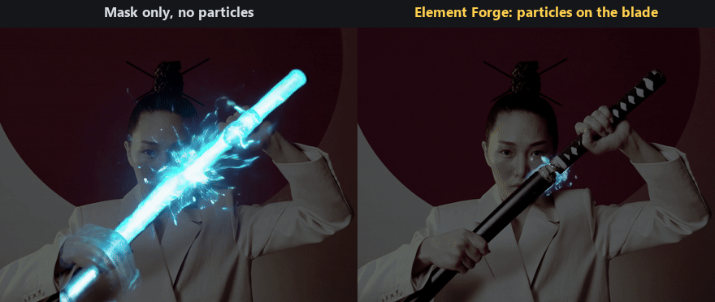
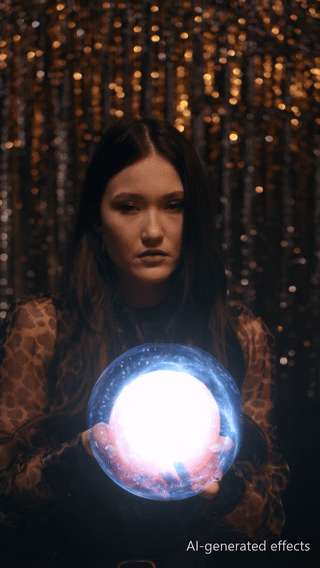
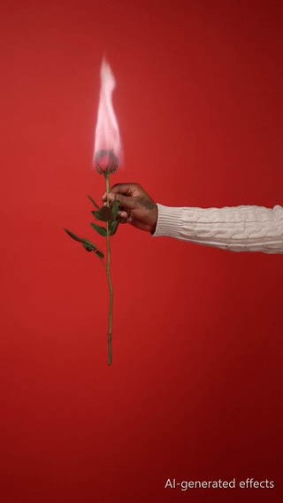
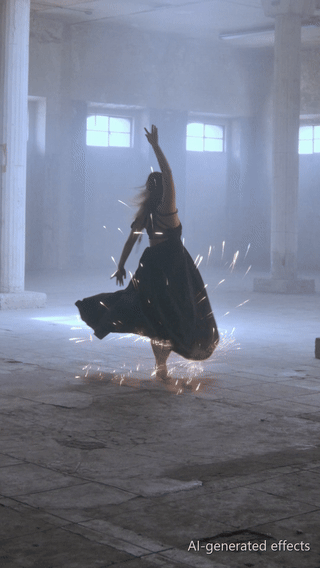

<h1 align="center">
  <picture>
    <source media="(prefers-color-scheme: dark)" srcset="docs/assets/branding/logo-on-dark.svg">
    <source media="(prefers-color-scheme: light)" srcset="docs/assets/branding/logo-on-light.svg">
    
  </picture>
</h1>

<p align="center"><strong>AI effects you control, right in the shot.</strong></p>

<p align="center">
  <a href="#control-not-just-generation">Control</a> ·
  <a href="#examples">Examples</a> ·
  <a href="#how-it-works">How it works</a> ·
  <a href="#get-started">Get started</a> ·
  <a href="#documentation">Documentation</a>
</p>

A prompt alone decides little: the AI guesses where an effect goes, how big it is and how it moves. **Element Forge lets you decide that.** Add fire, lightning, smoke, sparks or magic to your own footage in ComfyUI: particles simulated in your shot show the AI where to go, and the open video model **LTX-2.5** paints the look on your own GPU.

The particles also work without AI, as a finished effect of their own. Use the guided app or the same nodes in your own graph.

https://github.com/user-attachments/assets/468b014c-f544-41fe-b26f-fd6da37d78a3

<p align="center"><em>The release video.</em> <a href="https://youtu.be/Cz7dW70VSNg">Watch it on YouTube</a><br><sub>AI-generated effects; stock footage.</sub></p>

<br>

## Control, not just generation

<p align="center">
  
</p>
<p align="center"><sub>Same clip, same model and seed. Left: only the object's mask guides the AI, so the whole sword becomes the effect. Right: Element Forge's particles, born only on the blade, guide it, and the blade's contour is kept, so hand and handle stay as filmed.</sub></p>

<table>
  <tr>
    <td width="33%" valign="top">
      <h3>📍 You choose the place</h3>
      <p>At a point, in an area, on the object, between two points or over the whole frame, for <b>every style</b>. Set the object's mask on any frame and correct it with clicks or words.</p>
    </td>
    <td width="33%" valign="top">
      <h3>✨ Particles know the scene</h3>
      <p>Depth hides them behind nearer objects; they bounce, slide or stick on surfaces and move with the object and the camera. You see them <b>live, before any AI run</b>.</p>
    </td>
    <td width="33%" valign="top">
      <h3>🎯 The AI follows them</h3>
      <p>The simulation is drawn for LTX-2.5 as a <b>guide</b>: lines, heat, volume or depth. The effect takes the particles' <b>path, timing and spread</b>.</p>
    </td>
  </tr>
</table>

### Bonsai: from words to particle settings

Describe the effect you want. The optional, local **Bonsai** assistant can **enhance your prompt** and **suggest matching particle settings**. Review the suggestions, choose which values to apply, and watch the sliders and live preview update — **before generating with LTX-2.5**.

Fine-tune every slider yourself, or build the particles entirely by hand. **Neither Bonsai nor a preset is required.** [Set up Bonsai](docs/setup.md#bonsai-2).

**Also yours to decide**

- **The object crumbles:** a statue falls apart into particles under its own flames, the scene behind it filled in.
- **From a picture:** start from up to three pictures of an effect you like; the optional Bonsai model proposes the style, words and particle values for the spot you clicked.
- **One-click basics:** colour, amount, speed and size for every style, as words for the AI and as values for its particles.
- **After the run:** light, glow, colour, placement and timing change without generating again; every run is kept as a version.

<br>

## Examples

<table>
  <tr>
    <td align="center" width="25%" valign="top">
      <a href="https://github.com/Zitroffi/comfyui-element-forge/releases/download/examples/orb.mp4"></a><br><strong>Energy around a ball</strong><br><sub>AI · follows the ball</sub>
    </td>
    <td align="center" width="25%" valign="top">
      <a href="https://github.com/Zitroffi/comfyui-element-forge/releases/download/examples/rose-flame.mp4"></a><br><strong>Cold flame on a rose</strong><br><sub>AI · follows the blossom</sub>
    </td>
    <td align="center" width="25%" valign="top">
      <a href="https://github.com/Zitroffi/comfyui-element-forge/releases/download/examples/dress-sparks.mp4"></a><br><strong>Sparks from a dress</strong><br><sub>AI · particles start at the hem</sub>
    </td>
    <td align="center" width="25%" valign="top">
      <a href="https://github.com/Zitroffi/comfyui-element-forge/releases/download/examples/fireflies.mp4"></a><br><strong>Fireflies over a lake</strong><br><sub>Particles only · no AI run</sub>
    </td>
  </tr>
</table>

<p align="center"><sub>Click a clip for the full MP4. AI effects made with LTX-2.5; footage from Pexels and Mixkit. All clips, stills and GIFs are in the <a href="https://github.com/Zitroffi/comfyui-element-forge/releases/tag/examples">examples release</a>.</sub></p>

<br>

## How it works

Five steps in the app. Choose from fire, lightning, sparks, smoke, magic, weather, debris, liquid and dissolve styles, or describe your own effect; experimental styles are marked before you generate.

<table>
  <tr>
    <td width="33%" valign="top">
      <h3>1 · Clip</h3>
      <p>Load a <b>video or a picture</b>. <b>Depth, surface normals and camera motion</b> are worked out once per clip.</p>
    </td>
    <td width="33%" valign="top">
      <h3>2 · Position & Track</h3>
      <p>Click where the effect belongs. It follows a <b>point, an object or the camera</b> and can <b>hide behind the object</b>.</p>
    </td>
    <td width="33%" valign="top">
      <h3>3 · Effect</h3>
      <p><b>Basic:</b> one of <b>32 styles</b> or your own words, generated by LTX-2.5.<br><b>Advanced:</b> build the particles <b>live, without AI</b>.</p>
    </td>
  </tr>
  <tr>
    <td width="33%" valign="top">
      <h3>4 · Scene & finish</h3>
      <p>Light, glow, colour and placement <b>live, without a new run</b>. Combine <b>several effects</b> on one clip.</p>
    </td>
    <td width="33%" valign="top">
      <h3>5 · Output</h3>
      <p>Compare versions and export video or <b>EXR passes</b> for compositing, with <b>NVIDIA × 2 or HDR</b>.</p>
    </td>
    <td width="33%" valign="top">
      <h3>Node graph</h3>
      <p>The <b>Element Forge</b> template runs the same graphs as ordinary ComfyUI nodes.</p>
    </td>
  </tr>
</table>

### All features

<details>
<summary><b>1 · Clip</b> &nbsp;·&nbsp; load, analyse</summary>
<br>

- **Sources**<br>Load a video or a still picture. In a node graph, EF Shot also accepts frames with a frame rate.
- **Analysis**<br>Depth, surface normals and camera motion are worked out once per clip. Every effect on the clip reuses them.

</details>

<details>
<summary><b>2 · Position & Track</b> &nbsp;·&nbsp; points, objects, camera, masks</summary>
<br>

- **What it follows**<br>Click where the effect belongs. It follows that **point**, the whole **object**, the **scene** while the camera moves, or stays fixed on **screen**.
- **Two points**<br>Shift-click a second point for effects that connect two positions, such as lightning or energy.
- **Track check**<br>An object word helps find what to follow. The track check shows the path and the object's mask before you generate.
- **Masks**<br>Hide an effect behind the selected object with its mask, completely or as a glow, with a soft edge, or keep the base of an effect on its tracked point. Set the mask on any frame of the clip (a blade drawn only later), add parts and leave parts out with clicks or words; the track runs from that frame both ways.

</details>

<details>
<summary><b>3 · Effect · Basic</b> &nbsp;·&nbsp; 32 styles, your words, overlay or inpaint</summary>
<br>

- **Styles**<br>32 styles in nine groups, from flames, explosions and lightning strikes to snow, liquid and dissolve, plus your own effect.
- **Words**<br>Describe the look, motion and contact. **Enhance** can refine them when a language model is installed. With the optional Bonsai model (a small local vision-language model, see [setup](docs/setup.md#bonsai-2)), **Describe what you want** suggests a style and its words; you see each change before you apply it. For particle styles, **Particles in your words** turns a sentence such as *slow green sparks that spiral up* into emitter values.
- **From a picture**<br>Add up to three pictures of an effect you like. Bonsai sees them beside your clip with the chosen place marked, proposes the style and its words for that spot, and then sets the particles to match the pictures.
- **Three routes**<br>**Overlay** generates the element separately. **Inpaint** generates it inside the footage for contact with surfaces. **Particles only** draws any style with its particles, without AI generation.
- **Several effects**<br>**＋ Effect** adds another effect to the same clip, each with its own settings and versions.

</details>

<details>
<summary><b>3 · Effect · Advanced</b> &nbsp;·&nbsp; live particle simulation, guides for the AI</summary>
<br>

- **Live, without AI**<br>The **Emitter** shows the same controls for every style: a preset only sets their values. The live preview simulates the particles on your clip with the same engine and seed as the run.
- **Part of the scene**<br>The clip's depth hides particles behind nearer objects and lets them bounce, stick, slide or die on surfaces. The object's mask and track carry the emitter; the clip's motion and the camera move them along.
- **Three uses**<br>Keep the simulation as the finished effect, let it guide LTX-2.5, or draw it over the AI element.
- **Guides for the AI**<br>Besides the particles, the AI can follow the object's shape or a path you paint on the canvas. The **Spirit** styles give it the object's depth: their particles are born inside a held object, so the guide shows energy flowing through a blade and around the hand rather than one solid shape. Keep the mask on the part that should carry the energy.
- **Out of the box**<br>Every particle style starts from tested values, marked on each slider. Changed values are highlighted and go back one by one.
- **Fill from the prompt**<br>With the optional Bonsai model, **✦ Fill from the prompt** reads the effect's words and proposes the emitter values to change, each with its reason. You tick what to apply and undo it in one step.
- **Calm or lively**<br>Speed at the end, a speed limit, spin and turbulence that fades in or is calmed by drag make slow, drifting particles as easy as fast bursts.
- **Keep it**<br>**Save as my effect** stores the emitter values for every clip. See [Make your own effects](#make-your-own-effects).

</details>

<details>
<summary><b>4 · Scene & finish</b> &nbsp;·&nbsp; light, glow, placement, timing, clip grade</summary>
<br>

- **Light and colour**<br>Set the light the effect throws on the scene, its glow, brightness and colour. The light falls off with the distance in the scene: a wall right behind the effect catches more than a background far away. An effect can also be **lit by the other effects**, such as smoke near a flame.
- **Placement and timing**<br>Move, scale and rotate the effect in the canvas. The timeline sets start, end and fades; Advanced adds keyframes.
- **Clip grade**<br>Brightness, warmth, colour strength and a depth blur that keeps the focus on the effect.

</details>

<details>
<summary><b>5 · Output</b> &nbsp;·&nbsp; preview, versions, formats, EXR passes, NVIDIA</summary>
<br>

- **Preview and final**<br>Start with a fast **Preview**, then **Make final** for the full-size version, for Overlay and Inpaint. **Add passes** creates missing passes without generating the effect again.
- **Versions**<br>Every run becomes a version. Show and compare versions and restore their settings.
- **Formats**<br>Export the composite as MP4, ProRes, H.265 10-bit, PNG or EXR.
- **Passes**<br>Export separate scene-linear EXR passes (linear light, for Nuke, After Effects or Resolve): effect passes, plate, depth, normals and the object's mask, each on its own.
- **The clip alone**<br>Export a clip without an effect, with its passes, NVIDIA upscaling or HDR.
- **Upscaling and HDR**<br>**LTX × 2** adds detail in a second pass; **NVIDIA × 2** is fast. In the export, NVIDIA upscaling and HDR run on the plate only, with the effects kept as they are, or on the finished comp.
- **Element library**<br>Save an AI element to a library and place it in other shots without generating it again.

</details>

<details>
<summary><b>Node graph</b> &nbsp;·&nbsp; the same graphs as ordinary nodes</summary>
<br>

- **Template**<br>The **Element Forge** template uses the same graphs as the app, as ordinary ComfyUI nodes.
- **Building blocks**<br>**EF Unpack** exposes the footage, element, alpha and passes. Compositing tools include glow, depth light, unmult, deflicker and dither.
- **Other generators**<br>Bring frames from another generator into the placement workflow with **EF Element from Images**.
- **Scripting**<br>The graphs in `api_workflows/` can be used for scripting.

</details>

<br>

## Get started

> [!NOTE]
> **Requirements**<br>**ComfyUI 0.41.2 or newer**, the two node packs below and the [required models](docs/setup.md#default-models).
>
> **Tested hardware**<br>The AI routes have been tested with NVIDIA GPUs from **11 GB VRAM** on Windows and Linux. This is a tested configuration, not a confirmed minimum. Other GPU platforms have not been tested.
>
> **Disk and memory**<br>Allow about **45 GB** for the default models; RAM use varies with the models and clip size.

### 1. Install

With ComfyUI's Python environment active, run this from the ComfyUI folder. For **Windows portable**, use the [embedded-Python instructions](docs/setup.md#install-the-node-packs).

```bash
cd custom_nodes
git clone https://github.com/yuvraj108c/ComfyUI-Video-Depth-Anything
git clone https://github.com/Lightricks/ComfyUI-LTXVideo
git clone https://github.com/Zitroffi/comfyui-element-forge
python -m pip install -r ComfyUI-Video-Depth-Anything/requirements.txt
python -m pip install -r ComfyUI-LTXVideo/requirements.txt
python -m pip install -r comfyui-element-forge/requirements.txt
```

### 2. Add the models

Follow the [model list](docs/setup.md#default-models) for filenames, download links and folders, then restart ComfyUI. The app's gear menu shows each model's status and source.

Prompt enhancement, Bonsai, NVIDIA upscaling and HDR are optional. You can add them later through the [setup guide](docs/setup.md#optional-additions).

<br>

## Your first effect

Start with a short clip and an overlay effect.

1. **Open the app**<br>**Templates → Extensions → comfyui-element-forge → Element Forge (app)**.
2. **Clip**<br>Load your clip.
3. **Position & Track**<br>Click where the effect belongs and choose what it follows. Check the track before generating.
4. **Effect**<br>Choose a style and describe what you want. Use **Preview** quality when available, then **Run**.
5. **Scene & finish**<br>Adjust the result. Light and glow controls depend on the passes available in the selected version.
6. **Output**<br>Export a finished video or image sequence, with separate EXR passes when needed.

> [!TIP]
> **Prefer a node graph?**<br>Open the **Element Forge** template instead. It uses the same underlying graphs as the app. See [the workflow guide](docs/usage.md#use-the-workflow).

<br>

## Make your own effects

1. **Describe it**<br>Choose **Your own effect** and describe any element in words. It is generated with LTX-2.5 and stays on the point you click. Things that glow work best.
2. **Shape it with particles**<br>Switch the app to **Advanced**. The **Emitter** has the same controls for every style, and the **live preview** shows the particles on your clip with the same engine and seed as the run, without AI. **✦ Fill from the prompt** can set them from your words.
3. **Keep it**<br>**Save as my effect** stores the style, its words, the emitter values and the switches. Clip, position and track stay with the shot. Your saved effects appear under **My effects** for every clip, ready to load, rename or delete.

### Particles in detail

<details>
<summary><b>How the particle simulation works</b> &nbsp;·&nbsp; emitter, forces, depth, look</summary>
<br>

Element Forge has its own particle engine. It uses the clip's analysis, so particles behave like part of the scene.

| Stage | What happens |
|:---|:---|
| **Emitter** | Particles start at a point, between two points, along a drawn path, in an area, across the whole frame, on an object, along its outline, on its outline and inside, along its bottom edge, or in groups placed in depth. |
| **Birth** | Each particle gets a life, size, speed and direction: at an angle, outward from the object, against the emitter's motion (grinding sparks) or random. Rate and bursts decide when they appear, **Rate over time** draws it as a curve (an explosion fires nearly all at once). Pre-roll runs the simulation before the clip starts, so snow or rain already fills the first frame. |
| **Forces** | Every step applies gravity, wind, drag, swirling turbulence (curl noise), a vortex around the emitter, attraction to point B and flocking, where neighbours pull together into streams and drops. The presets follow how the real effects behave: an explosion brakes hard and rolls up into a mushroom, embers rise and then fall, snow sways, big raindrops fall faster, sparks burst in mid-air. |
| **Motion from the clip** | Particles take on part of the emitter's movement. Optical flow of the footage lets moving things carry them along, such as a hand sweeping through smoke. The measured camera motion keeps them in place in the scene while the camera moves. |
| **Depth and contact** | Each particle has a depth in the scene. Nearer objects hide it, and where it meets a surface it can bounce, stick, slide or die. Rain and liquid drops splash on impact. |
| **Look** | Sprites (soft, dot, flake, puff, wisp, streak, spark or chunk), colour and size over the particle's life, trails, motion blur, flicker and glow. **Merge into one body** blurs neighbouring particles together for liquid edges or fire tongues. |
| **Paths** | Lightning is drawn as jagged, branching bolts that change shape every few frames, or as a strike from the sky that flashes at a burst and flickers in the same channel, or as random bolts shooting off the emitter. Climbing arcs run along the thin parts of an object. Cracks and frost grow across a surface. |
| **Dissolve** | The object's mask crumbles into particles while the background behind it is filled in (from other frames, the rest by LTX with a soft edge), or bursts apart from its centre (*Explodes*). Any other effect can crumble its object too (**Crumble** in the emitter), so an explosion can blow up the object it sits on. |
| **Seed** | The same particle seed gives the same particles in the live preview and in the run. **New** tries other particles with the same settings; **Keep** locks the seed. |

</details>

<details>
<summary><b>Particles and the AI</b> &nbsp;·&nbsp; drawn, guiding, or both</summary>
<br>

Particles can be the whole effect or steer the AI.

| Route | What happens |
|:---|:---|
| **Particles only** | The simulation is the finished effect. No AI generation; the fastest route. |
| **Particles guide the AI** | The particles set where and how the element moves. LTX-2.5 paints its look. |
| **Also draw the particles** | Drawn particles are added over the AI element. |

The AI can also follow an object's shape (a flame wraps round a fist) or a path you paint, or work from the prompt alone. **Guide strength** sets how closely it follows.

</details>

<details>
<summary><b>Emitter controls</b> &nbsp;·&nbsp; every control by group</summary>
<br>

| Group | Controls |
|:---|:---|
| **Source** | Guide for the AI and how the particles are drawn for it (lines, volume, heat, depth of the object with the particles in front), the particles it starts from, also draw them over the AI's element, emitter shape and size, the scale of the whole effect (seen from far away), maximum particles alive at once |
| **Emission** | Rate, burst (once or again and again), rate over time (a curve), timing, pre-roll |
| **Motion** | Direction and spread, bunching to the centre, speed and its variation, speed at the end, speed limit, how far the particles follow the emitter and the clip, whether the AI follows the motion |
| **Particle** | Look (glowing, solid or contrast), life, size and colour over life, the clip's colour, lit by the clip, colour variation, sprite, trail, glow, flicker, fades, motion blur, opacity, spin, a second class of small particles |
| **Merge** | Blur, choke, edge and fill of a single body |
| **Forces** | Gravity (at the real 9.81 m/s² for a frame height you set, easing off over the life), wind, drag, mushroom roll, sway, turbulence (fades in, calmed by drag), vortex, attraction to B, flocking (reach, pull) |
| **Contact & depth** | Collision, bounce, friction, lying time, a splash where particles hit, depth offset and spread, hidden by the scene |
| **Paths** | None, a bolt from A to B, a strike from the sky onto A, a charge climbing the object, or cracks spreading from A, drawn over the particles: width, jaggedness, branches and each path's own values |

With the optional Bonsai model, **✦ Fill from the prompt** proposes these values from the effect's words; you tick what to apply.

In a node graph, connect **EF Particles** to EF Element for the same settings. See the [node reference](docs/nodes.md#options).

</details>

<br>

## Documentation

- **[Setup and troubleshooting](docs/setup.md)**<br>Dependencies, models and optional additions.
- **[Usage guide](docs/usage.md)**<br>Tracking, masks, generation modes, versions, export and reusable elements.
- **[Node reference](docs/nodes.md)**<br>Extend the supplied workflow or build your own.
- **[Particle depth and mask tools](docs/particle-depth.md)**<br>Guide LTX with particle depth, pick the part of an object that emits and keep its contour.
- **[Report an issue](https://github.com/Zitroffi/comfyui-element-forge/issues)**<br>Include the error and steps to reproduce it.

## License

The code, app and workflows use the [MIT License](LICENSE). Models retain their own licenses and conditions. See the [model license summary](docs/licenses.md) before using or publishing their outputs.
